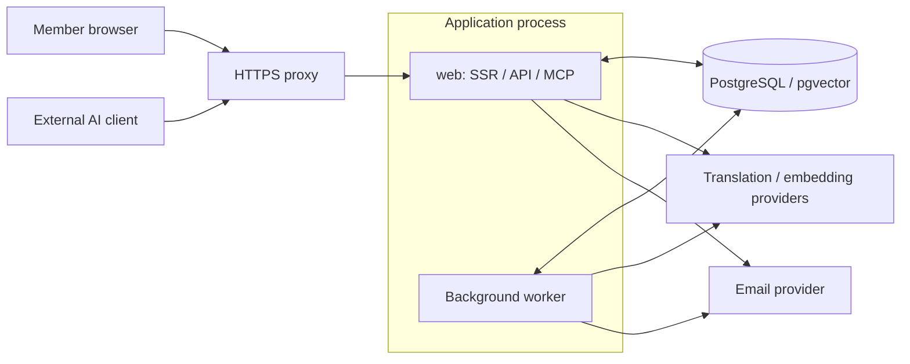

# tomola Public Design

[日本語](architecture.ja.md)

Implementation checked: 2026-11-08 (static checks of the features and settings covered by this revision). The Japanese text is the reference for this document; the English version uses matching sections.

This document explains tomola's purpose, design principles, main features, and architecture for developers. “Current implementation” refers to the code examined for this snapshot. It does not mean that a site has been deployed, tested on real devices, or had its translations reviewed. Future work is separated in section 10.

[Design decisions and rationale](design-decisions.en.md) preserves reasons, changes from earlier choices and limits. Architecture explains the structure; the rationale document explains the history needed when revising it.

## 1. Purpose and design principles

tomola is a forum for exchanging different perspectives across languages. Participants develop and write their thoughts in their own language and move between originals and translations while reading questions, positions, and reasons. Short remarks and long articles share the same platform; the software does not restrict the subject area.

The goal is not to produce a single consensus. It is to keep different premises, minority positions, and objections to a question's framing visible, allowing participants to update their own views. Language is a unit for display and counting; the design does not assume a one-to-one correspondence between language and worldview.

Six principles guide the design:

1. **The original is authoritative.** Translations are versioned derivatives, and a route back to the original remains available.
2. **Readers choose what to read and which views to accept.** Orderings can be chosen, and the rule of each ordering is the same for everyone. The platform produces no conclusion and no overall score for people.
3. **People take responsibility for their contributions.** Writing with or without AI is allowed; members check what is published in their name.
4. **The platform's AI output is not authoritative.** Translation and search provide assistance; AI does not decide the community's conclusions or write its consensus.
5. **Keep minority reasons and objections visible.** Majority reaction counts cannot occupy all the slots for reasons.
6. **Allow appeals and exit.** Avoiding domination by operators, language groups, or AI is a design goal. Moderation records and personal data export support it.

See [tomola's principles](../app/content/principles/en.md) for the member-facing explanation. Usability, presentation, and notification details can change while respecting these principles.

## 2. Current scope and member experience

Creating an account currently requires an invitation; there is no public self-registration setting. With `PUBLIC_READING` unset, reading posts also requires membership. `PUBLIC_READING=1` permits signed-out reading of home, threads and replies, source-language lists and public villages. Eligible topics have no village or belong to a public-kind village with a URL. There is no creation-date boundary: existing eligible posts become readable too. There is no option to publish only posts made after the setting changes. Ordinary deletion and hiding exclusions remain.

At `/invites/new`, operators can paste up to 20 email addresses at once and send an individual, recipient-bound invitation email from tomola in a selected enabled language, or copy the links themselves. The existing limit of 20 invitations per day remains; ordinary members still create one link at a time and deliver it themselves when member invitations are enabled.

Writing, member pages, following lists, chat, and protected machine reads such as search and stance aggregates require membership and the relevant permissions. Principles, why pages and guidance such as `llms.txt` are independent of post visibility. Readability is distinct from permission to reuse posts or publication of the software.

| Area | Current mechanisms |
| --- | --- |
| Reading and writing | Post rows and bodies, topics and replies, optional titles, Markdown/rich editing/math/code, images, drafts, editing and deletion |
| Languages | Originals and translations, readable/display-language settings, translation reports, human corrections, glossary |
| Opinion formation | Insightful reactions, questions, unnamed positions, attributed reasons, framing objections and alternative questions |
| Discovery and return | New-post/recent-reply/most-Insightful ordering, source-language lists, semantic search, topic follows, notifications and email, private saved lists, public site/village RSS |
| Working with AI | Markdown representations, read credentials, REST draft creation, MCP reading and client-specific drafts |
| Villages | Personal villages, language villages, member-created open and member-posting public villages, member-only chat |
| Accounts and operation | Six-digit email codes, confirmation links and passkeys, invitations, member pages, roles, reports/moderation/appeals, personal export, account deletion, operator observations |

Supported language tags are `ja`, `en`, `fr`, `de`, `zh-Hans`, `zh-Hant`, `ko`, `th`, and `vi`. Operators select which languages a site enables. A supported tag, generated text, and native-speaker review are different states.

Reading language can be chosen independently of interface language. An explicit page `?lang=` overrides the original-reading preference. Without it, readable-language preferences select originals; other posts use a translation selected from the member's translation-language preference and fallbacks. Only article headers offer a temporary reading-language menu; lists retain explicit language queries and carry them in their links. These choices preserve interface language. When that translation is unavailable, the original and a pending state are shown. The source language, translation state, and an action to return to the original remain visible.

Members save a display language for menus, buttons and default translations. The server chooses an enabled language in this order: language cookie, saved member preference, page `?lang=` (subject to its reading-only `rl` mark), `Accept-Language`, then the site default. Guests skip the saved preference. A shared `?lang=` changes the posts while a member retains the saved interface language. Explicit choices save both the cookie and account preference; ordinary visits and login only initialize an absent preference. Login does not set a language cookie, so devices without one continue to use the current account preference. If the preference lookup fails, interface language negotiation falls back to the guest rules. Registration aligns the display language and cookie with the selected main language when it is enabled, otherwise saving the signup screen language in the account without setting a language cookie. Original-reading languages and the main language remain separate settings; an optional translation-language override is under advanced language settings.

Members compose in a posting form or larger editor. Short posts can omit a title; a question asking for positions needs one. Source language is detected from prose, with enabled languages and member settings providing fallbacks. Authors can correct it after publication; translations and embeddings follow that source version. Ordinary posting does not require an AI-use declaration.

### 2.1 Villages and posting destinations

`VILLAGES=1` enables villages. Each member has a personal village addressed as `@handle`, where only that member can start topics. Alongside language villages, members can create freely joined `open` villages and `invite_public` villages where members start topics. Owners invite registered members; joining and co-ownership require the recipient’s acceptance. Personal and shared villages are public kinds, but signed-out reading depends on `PUBLIC_READING`. Any member can reply; membership controls starting topics and using shared chat. `closed` exists in the schema but has no supported creation or reading flow. Ordinary readers and missing-translation reconciliation use the shared place condition to exclude closed topics and their replies.

Topics can target the member's own personal village or an active shared village they have joined. Members cannot start topics in someone else's personal village. An unspecified destination resolves at publication to the member's default, falling back to their personal village. Draft creation with omission or `null` saves an unspecified destination; update omission preserves the saved choice, while `null` clears it. An explicitly invalid village never silently falls back. Replies inherit the root topic's place. Management includes invitations, co-owners, leaving, ending and history. Operators handle village reports; operator corrections or closure of member-created villages use recorded moderation subject to appeal. A village records the language its name and description are written in (its author's main language by default, changeable by the owner). Readers of other languages see them machine-translated like posts, with the original one press away; a language village's name comes from each screen's language instead. See [deployment preparation](deploy.md#village-preparation) for placing existing data before enabling the feature.

Signed-in members can see the display names, handles and roles in shared non-language village rosters, including ended villages, in pages of 50. Language villages show counts only. Rosters are absent from signed-out HTML and loader data, Markdown/text, MCP/API and member profiles. Joining screens explain this visibility; registration invitations can still attach a village. Village pages also list up to 20 authors of visible topics, most recent first, without post counts; this public authorship list is independent of membership. Chat shows its current member audience count and links to the roster except in language villages. Successful management actions show a status message.

### 2.2 Member pages and mentions

Usernames are identifiers using lowercase ASCII letters, digits, `_` and `-`. Ordinary new-name changes require a ninety-day interval; previous names are reserved for ninety days. Returning to an active own reservation does not extend the ordinary-rename waiting period.

`/u/:handle` is a member-only page listing the member's undeleted, unhidden topics in public-kind places. An owned non-question post can serve as an introduction. Pages show neither an overall reaction score nor personal unnamed positions. Mentions save the public ID resolved when written and link through `/u/id/:publicId` to the current username. Name reuse and rerendering do not retarget old mentions to another person.

### 2.3 Village chat

`VILLAGE_CHAT=1` requires `VILLAGES=1`; both default off. Ordinary chat access requires current village membership and acceptance of the current consent version. An owner or operator role alone grants no ordinary message access. Plain-text messages, committed per-village change sequences and read cursors use separate tables. Browser change fetches and content-free SSE signals synchronize them. SSE connections are managed within one process; periodic fetches catch changes from other processes.

Consent, translation, mentions/unread notices, reports, hiding/restoration and appeals are implemented. During report or appeal review, authorized operators and language moderators can read the target snapshot and surrounding messages. Review reads require POST and record reader, case, reason, versions and ranges in `chat_access_log`. Additional context expansions require a reason and are limited to three per reviewer per case. Operators inspect the records at `/admin/chat-access`.

Chat is excluded from public posts, Markdown, API, MCP and search. `/settings/chat` and personal exports include a member's undeleted messages even after leaving a village. Deletion empties the message body and removes translations; review snapshots follow separate retention conditions. Legal review of the communications rules that apply to a site before enabling chat there, and streaming checks through actual proxies remain distinct from feature implementation.

### 2.4 Images

Member uploads accept JPEG, PNG and WebP and reject animation. Input is limited to 10 MiB and 40 million pixels. An isolated decoder process applies orientation, re-encodes to WebP within a 2,000-pixel longest edge and strips metadata. Only converted images of at most 2 MiB are stored; originals are not saved in the database. Processing has time and memory limits.

Converted bytes reside in the `media` table. Limits are 30 uploads per member per hour, 300 stored images and 100 MiB per member, 10 GiB site-wide, and 30 inline images per rendered body. Unused images are readable only by their uploader. Used images are checked against references in that uploader's own posts and permissions concerning deletion/hiding of the post and its parent; membership also follows `PUBLIC_READING`. Knowing a URL alone does not grant access. Delivery uses `private, max-age=86400`, so withdrawing delivery does not guarantee immediate removal of an existing device copy. Members can delete images at `/settings/media`; operators use a recorded moderation path.

With `FIGURE_TRANSLATION=1`, the software can read labels in posted figures and produce translated image variants. Reading sends the stored WebP bytes to an external model; extracted labels go to the primary translator. The stored source figure remains available, distinct from the pre-upload image, and readers can return to it from a variant. The feature defaults off and shares the ordinary translation queue and monthly budget. Unavailable reading, translation or rendering leaves the original visible; temporary failures have bounded retries. See [deployment](deploy.md#existing-figures) for settings and existing-image processing.

## 3. Writing with and without AI

### 3.1 Browser posting

A member enters content and submits it. Markdown is the canonical body. Rich editing is the normal mode, with direct Markdown editing available. Bodies containing math or frontmatter use Markdown editing to avoid destructive conversion. Mode choice is stored on the device; opening and closing an unchanged body does not normalize the original. Reading lists show titles, source languages and times, separating reading from composition tools.

Passkey signatures for posts, replies, edits, and username changes are a member setting, disabled by default. Registering a passkey is not a prerequisite for a first post.

When signing is enabled, an operation requires content-bound confirmation and a signature. Changing the signing preference in either direction and deleting a passkey require signing regardless of the post-signing setting. See section 8.

### 3.2 Drafts from external AI

External AI can read posts and create drafts within the permissions granted by a member. Drafts are bound to that member and the creating client. A client's credentials do not provide access to drafts created in the browser or by another client.

The member publishes in the browser. The AI-draft confirmation flow presents the full text, destination, last client, and changes. When the member has enabled signing, a passkey signature is added to this confirmation. API and MCP credentials cannot publish.

This is a permission and interaction boundary. It does not technically prove that a person understood the entire text, or that an AI cannot operate a browser.

### 3.3 Entry points for AI reading

Threads have `/t/:id.md` and text versions; home and source-language lists have Markdown versions. A thread with `lang=all` includes displayable translations in enabled languages and identifies pending translations. `llms.txt`, `/help/ai.md`, `/help/mcp.md` and `/api/openapi.json` are general guides without member content.

Eligible threads and lists are credential-free with `PUBLIC_READING=1`, but protected reads such as search, stance aggregates, the manifest and change feeds, and member `/mcp`, still require authentication. With public reading enabled, `/mcp/public` offers only publicly readable lists/threads and the fixed privacy statement. Member MCP offers reading and client-owned drafts, never personal unnamed positions, publishing or reactions. Posts and translations are untrusted user material, not instructions to an AI. See [MCP connections](guides/mcp-connect.md) for setup and village destinations.

## 4. Architecture

React Router server handlers and React views run on Node.js. Express is the production HTTP server. In the current startup configuration, web and background worker share one process. The worker executes jobs stored in the database.

Web-side model calls include search-query embeddings. Sign-in email is sent by web; notification email is sent by the worker. Where an external AI client processes data depends on the AI chosen by the member.

| Component | Technology and role |
| --- | --- |
| Runtime | Node.js, TypeScript, React Router, React, Express |
| Interface | Tailwind CSS, Paraglide for interface localization |
| Data | PostgreSQL, pgvector, Drizzle ORM and SQL migrations |
| Development database | PGlite, with a lock preventing concurrent processes from opening the same data directory |
| Authentication | Better Auth, WebAuthn/SimpleWebAuthn, OAuth and permission checks for MCP |
| LLMs | Google and Anthropic adapters behind a common interface; fake engines for development |
| Content and images | Markdown parsing and HTML sanitization, KaTeX, rich editing, isolated sharp image conversion |
| Validation | Zod, Vitest, Playwright, ESLint, disclosure checks, checks chosen for the scope of a change |

[package.json](../package.json) is authoritative for dependencies and commands. The current queue uses the database's `jobs` table and requires no separate message broker. The supplied Compose services are the application, PostgreSQL, and Caddy. PGlite is for development and checks; production uses PostgreSQL.

## 5. Data and revision model

[app/lib/db/schema.ts](../app/lib/db/schema.ts) defines the schema; [drizzle](../drizzle/) records migrations.

| Data group | Main role |
| --- | --- |
| Members, profiles, invitations, roles | Authentication, main/readable languages, signing preference, read/write permissions |
| Posts, replies, revisions | Original Markdown, language, reply targets, question attributes, source revision, hidden/deleted state |
| Translations, revisions, segments | Text bound to a source revision, model/prompt/glossary versions, correction and display state |
| Glossary, revisions, translation reports, disagreements | Translation candidates and notes, change history, retranslation, evidence for human review |
| Reactions, positions, changes, reason selections | Insightful reactions, current and changed positions, daily display slots |
| Drafts, API tokens, OAuth consent | Member/client boundaries, permissions, revocation, draft revisions |
| Signing challenges, evidence, key recovery | Content-bound operations, one-time confirmation, signature records, restricted recovery |
| Reports, moderation, appeals, follows, notifications | Operational decisions, member communication, return visits |
| Jobs, LLM usage, embeddings | Asynchronous processing, retries, budgets, semantic search |
| Villages, memberships, invitations, events | Destinations, participation/management authority, closure, village reports |
| Chat, consent, cursors, translations, evidence | Member-only messages, translation requests, deletion, scoped review reads and auditing |
| Images and post references | Converted images, ownership/storage limits, delivery eligibility |
| Saved topics | Private topic IDs and save times, never a public reaction or recommendation signal |
| Listing aggregates | Topic activity and counted Insightful reactions; derived data rebuildable from topics and votes |

A fingerprint identifies the original revision and binds translations, embeddings, and confirmations to it. A job for an older original must not overwrite the current translation after an edit. Replies under a hidden or deleted topic are also withheld from read results.

Unnamed position choices and attributed reason replies are separate records. Member views, Markdown, API, and MCP do not disclose who selected an unnamed position. The database nevertheless links positions to members. This is not cryptographic anonymity. Timing and distribution changes can still permit inference in small groups.

Personal exports and operator observation exports are separate. Ordinary read tokens and MCP do not expose a member's personal position/change records. Operator exports reduce direct identifiers but retain values such as post IDs and timestamps that can be correlated with site content. They are not anonymous data. They are restricted to operational use by operators; external sharing and anonymization for research are separate matters.

## 6. Translation and glossary

Publication and source edits queue provisional titles for every other enabled language. Body translation defaults to `TRANSLATION_EAGER_SCOPE=readers`: languages read by at least `TRANSLATION_EAGER_MIN_READERS` active members (default 1), plus the languages of members of the topic's village, members who follow that village, and the post's notification recipients. `all` translates bodies into every enabled language. Other bodies are requested when a browser reads the topic. Markdown, API, MCP, export and server-rendered reads alone never request work. Daily reconciliation and operator language-opening/requeue commands are separate paths. Under `readers`, `translations:requeue` recovers only pairs with a failed current-version job or suppressed current primary output. A failed title-only job recovers the title without requesting a missing body. Use `--all-missing` to include never-requested pairs, `--lang <tag>` to narrow the language and `--dry-run` to inspect pair and source-character counts. The default under `all` and the `langs:open` command still cover all missing pairs. Mail jobs take priority over title jobs, which take priority over body translation and other work; each tier retains due-time and job-ID order. Original publication completes before asynchronous translation, so the posting interface does not wait indefinitely for an external model.

1. Bind the source revision, target language, required context, and glossary to the work.
2. The worker translates with the primary engine and rechecks the source revision before saving. The body job refines a provisional title using at most 1,500 characters from that same post's own body; other members' posts and reports are excluded. Existing final titles remain unchanged.
3. Display originals, primary translations, and human corrections with translation and staleness state. Lists can show a provisional translated title, with muted text while the reader still lacks a body translation. Thread pages and their Markdown/text versions keep the original title and body with a pending notice until the body translation is available.
4. Retry failures within limits. Truncated output allows two total job attempts; empty or invalid output allows three, always bounded by the job limit. When a secondary engine is configured and permitted by the budget, try it immediately on primary refusal; for other primary failures, try it from the fourth attempt or the final permitted attempt, whichever is earlier. Fallback adds model calls within that same job attempt, and the saved primary translation records the fallback. Without an available fallback, refusal stops immediately and other failures stop at their limit. Persistent reasoning leaks stop immediately without fallback.
5. When disagreement measurement is enabled, record a secondary comparison translation and judgments about meaning or tone. These comparisons are not presented as an authoritative answer.

Source edits do not silently overwrite human corrections; their need for renewed review is tracked. When an automatic retranslation model is configured, a report has a one-time retry slot for the same source revision and target language. Reports without a configured retry model, and issues remaining after that retry, go to human review.

Glossary entries contain candidates and notes rather than one universally correct translation. Entries can originate in any language. Proposal discussion, adoption, and revision history are distinct. Changes affect subsequent translations or retranslations, without unconditionally retranslating every post. Simplified and Traditional Chinese are separate languages, with vocabulary differences included in translation.

Jobs have deduplication, queued/running/done/failed states, retries, and recovery after worker failure. Recorded LLM usage determines budget state and can reduce comparison work or pause processing. Internal usage estimates do not guarantee the provider's final bill.

Ordinary post translation, chat translation and other jobs have separate execution slots. Daily reconciliation with `TRANSLATION_BACKFILL_ENABLED=1` supplies missing current-version translations for topics and replies in public-kind places. Replies beneath a closed root are excluded even when their own village is NULL. Chat requests translations according to readers' languages, using at most two preceding visible human originals from the same village within ten minutes, plus the direct reply target, as context. Deleted, hidden or AI reply targets are excluded. Human reply targets predating the current consent version follow the same policy as preceding context. Messages retained after their author leaves can remain translation candidates.

### 6.1 External model inputs and settings

| Purpose | Enabling settings and conditions | Data sent |
| --- | --- | --- |
| Post/reply translation | `TRANSLATION_PRIMARY` and provider credentials. `TRANSLATION_SECONDARY` supplies fallback/comparison; `DIVERGENCE_JUDGE` judges comparisons. The latter two default off | Title/body, required translation context and glossary. Report retries configured with `TRANSLATION_RETRY_MODEL` use the same provider |
| Village name/description translation | Same as post translation (`TRANSLATION_PRIMARY`, `LLM_MONTHLY_BUDGET_USD`); `VILLAGES=1` | The name and description of a public-kind village, one language pair at a time, and glossary. No other member's text |
| Figure label reading/translation | `FIGURE_TRANSLATION=1`; `FIGURE_READING_MODEL` is vision-capable and belongs to the primary provider | Stored WebP bytes to the reading model; extracted labels to the translator. Shares ordinary monthly accounting and queue. Retains source figures and displays them on failure |
| Embeddings and semantic search | `EMBEDDING_ENGINE` and credentials | Post titles/bodies and search queries |
| Chat translation | `VILLAGES=1`, `VILLAGE_CHAT=1` and village consent. `CHAT_TRANSLATION_MODEL` uses the primary provider | Message body, context described above and glossary. Separate `CHAT_LLM_MONTHLY_BUDGET_USD` accounting |
| Chat Nushi | `VILLAGE_CHAT_NUSHI=1`, independent of posting’s `VILLAGE_NUSHI`, defaults off. Requires public reading, villages, chat, current consent and the village Nushi setting | Only the caller’s projected visible message and public posts from that village. Reply targets and adjacent chat are excluded; answers remain within chat. Allowances and budget are shared with posting Nushi |
| AI spam classification | `MODERATION_SPAM_ENABLED=1` and `MODERATION_AI_SPAM_ENABLED=1`; default off | Suspicious ordinary posts/replies: title, body and language. No chat bodies |
| AI report preparation | `MODERATION_AI_TRIAGE_ENABLED=1`; default off | Reported material, bounded surrounding context, report reason and reporter explanation. Village reports include saved/current names and descriptions |

Moderation AI uses `TRANSLATION_PRIMARY`'s provider and credentials with `MODERATION_AI_MODEL`. It prepares priority and assessment, not report dispositions. Spam output meeting strict conditions can feed rule-based automatic hiding. Detection with `MODERATION_SPAM_ENABLED` alone sends nothing externally. Moderation shares ordinary post accounting under `LLM_MONTHLY_BUDGET_USD`.

Chat AI preparation requires consent version 2 or later from the target author and every context author in that village. Without target consent nothing is sent. Candidates are bounded to ten messages on each side; nonconsenting authors are removed without extending the window. Consent is rechecked immediately before sending, and model, versions and ranges are audited. The current chat consent screen records version 4. It states provider conditions and includes direct reply targets in translation context and audited report review. Regardless of the chat Nushi switch, it also discloses external question processing and the answer audience when Nushi is available; the privacy notice lists the current providers and processing countries. Enabling a setting is not acceptance of consent.

## 7. Questions, reasons, and discovery

Insightful means gaining a new perspective, not agreement. Displayed reaction totals and position distributions include totals and the number of participating languages, without per-language breakdowns. Insightful counts are a clue for finding what to read. A reader can choose to order lists by them.

Positions are Agree, Disagree, and Neither. Reason replies can carry a position tag; framing objections and alternative questions are also supported. Once someone other than the author takes a position, the question's title and body are locked. Necessary corrections follow an authorized path with moderation records.

The reasons panel provides up to three slots for each position. Among replies by authors not yet shown, it randomly draws a source language not yet shown for that position. Within that pool, replies with at least one counted Insightful are preferred if any exist; it then randomly draws an author and one of that author's replies. Reaction-count ranking and AI assessment are not used. The first selection is stored for the question and UTC day and shared by all readers. New replies do not trigger another draw that day; deletion, hiding, exclusion or changed marks remove items immediately, with replacement the next day.

The home page defaults to new-post order. Recent-reply and most-Insightful order, and filters such as questions or titled posts, are explicit choices. Insightful ordering uses counted reactions to the root post, then creation time and ID; reply votes are not added. Activity and reaction order use derived `topic_listing_stats`; creation order reads the source table. See the [rebuild runbook](runbooks/topic-listing-stats.md) for checking and repairing aggregates.

On the first page of an unfiltered newest-first list, new-post marks compare creation times with the newest post shown on the previous visit. Members store this boundary in their account across devices; signed-out readers store it in their browser. A same-origin browser POST after initial activation exchanges the previous boundary and advances it without moving it backwards. List loaders and prefetches do not advance it. Each account retains at most 50 list boundaries, deleted with the account; no individual topic-opening history is recorded. The boundary stays fixed during one visit, and a first visit or failed synchronization shows no marks. Reply marks remain browser-local; notifications and chat read positions are separate.

Related discussions come from topic links in original posts, separately from AI recommendations. Semantic search compares multilingual query and post embeddings through pgvector, then displays results in the reader's language. Search similarity is not a truth score or a member reputation score.

The private saved list at `/saved` orders topics by save time. Saving is neither publicly exposed nor a recommendation signal. RSS at `/feed.xml` and `/v/:slug/feed.xml` supplies site and village topics only with `PUBLIC_READING=1`, restricted to visible topics readable without login. Saved lists and public feeds have separate access boundaries.

## 8. Authentication, permissions, and trust boundaries

| Access path | Permissions and boundary |
| --- | --- |
| Member browser | Session identity plus per-operation membership, role, and input checks; operations such as publication, positions, reactions, and reports |
| Read token | Authorized reads only; cannot create drafts or publish |
| Draft token | Draft access; cannot read ordinary member posts or publish |
| MCP | Active membership and `read`/`draft` permissions; personal tokens or OAuth, with consent, revocation, and client boundaries checked |
| Open in AI link | Publicly readable resources use a credential-free URL with a non-authorizing `o` marker. Protected resources use member-issued, resource-scoped five-minute `oai2` credentials |
| Operation and moderation | Role and language responsibilities checked; moderation and appeal records retained |

API tokens are displayed in plaintext only when issued; the database stores their hashes. Credentials in read URLs are not propagated into returned links. Member responses prevent shared caching, and access logs redact credential-bearing URL components.

Six-digit email codes and confirmation links work only in the requesting browser, expire after fifteen minutes and share a single use. MCP OAuth checks consent and revocation on each request. Dynamic client registration (DCR), including unauthenticated registration, is currently always enabled, with no operator on/off setting. Registration does not replace member authentication or permission consent.

When post signing is enabled, an approximately two-minute, one-time challenge binds the member, operation, content, destination, and draft revision. Verification checks WebAuthn user verification, Origin/RP ID, key, expiry, and non-use. Challenge consumption, key counter update, mutation, and evidence storage share one database transaction. Signing-preference changes and posting lock the same member row for consistency.

Signature evidence records an act of taking responsibility for particular content. It proves neither reading and understanding nor exclusive human use of a key. Unsigned posts do not receive signature evidence. Key enrollment, deletion, and recovery use authentication procedures separate from ordinary posting.

HTML derived from Markdown is sanitized. Input validation, same-origin checks, CSP, rate limits, and body-size limits are used. Other people's posts are marked as untrusted external data for AI. These boundaries do not guarantee that every external AI resists prompt injection.

## 9. Operation and data handling

Operator identity, terms, privacy notices, contacts and participation conditions are site-specific settings. Configure and review them through [Operator settings](deploy.md#operator-settings), matching the actual processing and presentation. General configuration and procedures are documented in [deployment](deploy.md), [development and verification](development.md), and [MCP connections](guides/mcp-connect.md).

Secrets are supplied at runtime through deployment environment variables, a restricted `.env`, or equivalent secret management. Real secrets do not belong in source, build images, or example configuration. Real databases, member posts, invitations, captured email, logs, and backups are excluded from software publication artifacts.

The service worker supporting home-screen installation limits its cache to static assets and common offline guidance. It does not persistently cache member post content on the device.

Production startup checks authentication configuration, external models, interface translation review state, and related conditions. Fake engines are for development and explicit staging without real member data. Migration and restore checks use isolated data. Shutdown stops new HTTP connections and job starts, then waits for active work to finish.

External model sending follows the purposes and conditions in section 6. Email sends recipient addresses and notification content. Operators align processing destinations and handling terms with member disclosures, including what members send to their external AI. A database storage location alone does not describe all processing locations or providers' retention and training terms.

Device notifications are disabled by default and can be enabled in settings only when `WEB_PUSH=1`. Replies, response posts and mentions are usually sent after about one minute, independently of email preferences. Registrations identify browser storage areas separately from login sessions; sending and opening recheck the recipient and current permissions. Notifications contain no post body, title, name or handle. Delivery providers receive destination identifiers, encrypted notifications, sender, time, frequency and size. Stopping prevents future sends; accepted notifications may remain for up to two hours. Verify operator disclosures and representative devices before enabling. See [deployment](deploy.md#device-notifications-web-push) for configuration and key rotation.

### 9.1 Current retention and deletion

Members can delete their accounts from settings; an operator command also exists. Members choose to retain posts under a shared departed-member identity or hide them immediately for scheduled erasure. Their chat messages are deleted, including in former villages. Identity, credentials, village ownership and evidence follow their own rules; this does not erase every record together. See [account deletion](runbooks/account-deletion.md).

Author-deleted topics/replies retain tree markers; daily maintenance erases source text, revisions and signed payloads after thirty days. Revisions referenced by moderation retain empty markers. Hiding, operator deletion and unresolved appeals protect content from this purge, and preservation holds apply. Holds stop automatic retention, not every explicit member/moderator action, external service or backup rotation. General draft expiry and comprehensive erasure of every record are not implemented. See [retention and preservation](runbooks/retention.md) and `app/lib/retention.ts`.

Daily maintenance removes ordinary completed/failed jobs after thirty days, retaining compact retranslation retry markers separately. Handled village-report snapshots and chat review bodies have 180-day pruning conditions. Open or recently handled related reports/appeals delay chat evidence pruning. Chat translation-report original/translated snapshots and notes are also cleared 180 days after handling, retaining case metadata. This does not erase every post, log or backup after 180 days.

Saved display names and avatar evidence expire 180 days after moderation or a report's handling. Unresolved appeals protect the same member's evidence for that identity kind; decided appeals extend protection until 180 days after the decision. Only the copied fields are cleared, retaining moderation/report history. Historical avatar bytes are erased once no profile, report, moderation snapshot or post references them. Account deletion clears identity evidence immediately.

Personal export format version 17 includes profile (with optional `display_name` and `display_name_latin`, plus `avatar`), owned undeleted posts/revisions, drafts, reactions, positions/changes, follows (topics and public villages), signatures, owned undeleted chat, and participation/stance consent records. `nushi_sources` contains only the member's saved source-attribution snapshots; account deletion anonymizes their author labels. `saved_topics` contains private saved topic IDs and save times. `push_subscriptions` contains registration counts, coarse browser/OS labels and registration dates, without delivery endpoints or keys. `profile.avatar` records whether a custom avatar is currently uploaded and includes its rewritten WebP bytes as base64. `village_icons` includes the current uploaded icon of each village the member owns, including shared ownership, with `village` (the slug), `mime` and rewritten WebP `base64` bytes. Chat is empty while disabled. The export does not include post image bytes or historical member or village icons retained as review evidence, and is not a complete export of deleted posts, memberships/ownership, reports or appeals.

## 10. Future directions and outstanding checks

The following are considered separately from current implementation:

- Per-topic public/member-only visibility, closed villages, general registration and comprehensive retention/erasure. Current public reading has no creation-date boundary, as described in section 2.
- How lists are divided as the community grows, including whether the most-Insightful order is limited to a period, is undecided.
- Member AI speaking with a clear AI identity, distinguished from a member's checked contribution.
- Multiple-system argument maps and more advanced full-text search. These do not become prerequisites for existing reading and writing.
- Appeals concerning principles, rules, and glossary decisions. These are distinct from the current appeals against moderation.

Native-speaker language review, real passkeys and devices, translation quality using actual models, and site disclosures and restore procedures require checks appropriate to the operating environment. Code and automated tests alone do not establish that these checks are complete.

## 11. Documentation and development practice

Design changes update this document with their rationale and relationship to current implementation. Japanese and English section numbers correspond; changes in meaning are reflected in both. The rationale document follows the same bilingual structure, retaining earlier choices and reasons for change alongside the current choice. Further language versions are added when readers and reviewers need them.

This document preserves specifications and rationale needed for implementation, rather than internal consultation records. Code is authoritative for types, validation, and database constraints; detailed specifications are not duplicated in full across multiple documents. Verification is proportional to the change, and documentation-only edits do not automatically require every application test.

`check:docs` handles documentation and disclosure checks; `test:fast` handles lint and no-database tests; `check:focused` covers explicit or selected files. Integration/release widen verification to types, databases, builds, budgets and browsers. Existing lint/disclosure findings are recorded in baselines and increases fail. Updating a baseline does not substitute for fixing a defect.

Ordinary browser scenarios have zero retries. A quarantine registry can allow one retry for an unstable case with a cause and repair deadline; it is empty at this snapshot. Recovered failures remain in the evidence. Reuse results only after checking SHA, input fingerprint, settings and exit status. See [development and verification](development.md) for scopes and commands.

The software license is [AGPL-3.0-or-later](../LICENSE).
