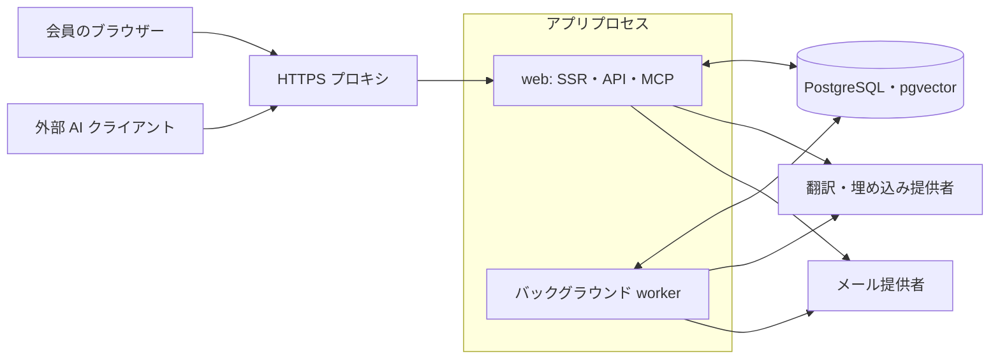

# tomola 公開設計書

[English](architecture.en.md)

実装照合日：2026-11-08（この改訂で扱う機能・設定の静的照合）。日本語版を本文の基準とし、英語版に対応する節を置きます。

この文書は、tomola の目的、設計原則、主要な機能、技術構成を開発者向けに説明します。「現在の実装」はこの整理時点のコードを指します。各サイトの配備、実機確認、翻訳の品質確認が完了したという意味ではありません。将来構想は第10節に分けます。

選択の理由、旧案からの変更、弱点は [設計の決定と理由](design-decisions.ja.md) にまとめます。全体設計は構成を、決定理由編は変更するときに守る判断の経緯を説明します。

## 1. 目的と設計原則

tomola は、言語をまたいで異なる見方を交わすためのフォーラムです。参加者は自分の言語で考えを書き、原文と翻訳を行き来しながら、問い、立場、その理由を読むことができます。短い発言と長い文章を同じ基盤で扱い、ソフトウェア自体は話題の分野を限定しません。

目的は、意見を一つの合意にまとめることではありません。異なる前提、少数の立場、問いの立て方への異議が見える状態を保ち、参加者自身が見方を更新できるようにします。言語は表示や集計の単位として用いますが、言語と考え方が一対一に対応するとは仮定しません。

設計の基準は次の六点です。

1. **原文を正本にする。** 翻訳は版を管理する派生物とし、原文へ戻る経路を残します。
2. **何を読み、どの見方を受け入れるかは、本人が選ぶ。** 並べ方は選べ、その規則はだれに対しても同じです。場の結論や、人の総合点は作りません。
3. **人が内容を引き受ける。** 手書きと AI を使った執筆を認め、人の名前で公開する内容は本人が確認します。
4. **場の AI の出力を正本にしない。** 翻訳と検索を支援に用い、AI に場の結論や合意文を決めさせません。
5. **少数の理由と異議を残す。** 多数派の反応数だけで、理由の表示枠を占められないようにします。
6. **モデレーションに異議を出せ、退出できるようにする。** 運営者・特定の言語の人たち・AI に権限を集中させないことを目標とし、モデレーション記録と本人のデータの持ち出しを用意します。

利用者向けの説明は [tomola の原則](../app/content/principles/ja.md) にあります。一般的な使いやすさ、表示の形、通知の細部は、これらの基準を守りながら見直します。

## 2. 現在の範囲と利用者の体験

現行版のアカウント作成には招待が必要で、一般登録を有効にする設定はありません。`PUBLIC_READING` が未設定なら投稿の閲覧にも会員資格が必要です。`PUBLIC_READING=1` なら、ホーム、話題と返信、原文の言語別一覧、公開のビレッジなどをログインなしで読めます。村のない話題と、公開種類で URL を持つビレッジの話題が対象で、作成日による区切りはありません。既存の対象投稿も読めるようになり、「設定を変えた後の投稿だけを公開する」機能はありません。削除・非表示の通常の除外条件は保ちます。

運営者は `/invites/new` にメールアドレスを 1 回に 20 件まで貼り、開いている言語から選んで、宛先ごとに結び付いた招待のメールを tomola から送るか、自分でリンクを写して渡せます。1 日 20 件の上限は変わらず、会員の招待を開いている場合、通常の会員はこれまでどおり 1 件ずつリンクを作って自分で届けます。

書き込み、会員ページ、フォロー一覧、チャット、検索や立場の集計などの保護された機械向け取得には会員資格・該当する権限が必要です。原則、作った理由、`llms.txt` などの案内は投稿の公開設定と独立しています。公開で読めることは、投稿の再利用許諾やソフトウェアの公開とは別です。

| 領域 | 現在の仕組み |
| --- | --- |
| 読む・書く | 投稿の行と本文、話題と返信、任意の題、Markdown・見たまま編集・数式・コード、画像、下書き、編集・削除 |
| 多言語 | 原文と翻訳、読める言語と表示言語の設定、誤訳報告、人手修正、用語集 |
| 意見形成 | 「なるほど」、問い、無記名の立場、名前付きの理由、問いの立て方への異議、別の問い |
| 発見と再訪 | 新しい投稿順・最近の返信順・「なるほど」の多い順、原文の言語による一覧、意味検索、話題のフォロー、通知・メール、本人の保存一覧、公開の全体・村の RSS |
| AI との利用 | Markdown 表現、読み取り用資格情報、REST の下書き作成、MCP の読み取り・クライアント別下書き |
| ビレッジ | 個人の村、言語のビレッジ、会員が作る公開のビレッジ、メンバーが投稿する公開のビレッジ、会員限定のチャット |
| アカウントと運営 | メールの6桁コード・確認リンク・パスキー、招待、会員ページ、役割、通報・モデレーション・異議、本人の書き出し、退会、運営用観測 |

対応する言語タグは `ja`、`en`、`fr`、`de`、`zh-Hans`、`zh-Hant`、`ko`、`th`、`vi` です。サイトで有効にする言語は運営設定で選びます。対応タグがあること、訳文が生成されたこと、母語話者が確認したことは区別します。

読む言語は画面の言語と独立して選べます。ページの `?lang=` による明示指定は、原文のまま読む言語の設定より優先します。明示指定がなければ、原文のまま読む言語には原文を、それ以外には本人の翻訳先設定などから選んだ言語の訳を使います。一時的に読む言語を変えるメニューは記事の頭だけに置きます。一覧は明示された言語を適用し、リンクへ引き継ぎます。この操作で画面の言語は変えません。訳がまだなければ原文と翻訳待ちの状態を示します。原文の言語、訳の状態、原文へ戻る操作を表示します。

会員の表示の言語は、メニュー、ボタン、既定の訳に使い、アカウントに保存します。有効な言語のうち、言語の Cookie → 保存した表示の言語 → ページの `?lang=`（読む専用の印 `rl` に従う）→ `Accept-Language` → サイトの既定の順に決めます。未ログインでは保存値の段階を飛ばします。会員が共有された `?lang=` で来ても、投稿だけがその言語になり、画面は保存した言語を保ちます。明示的な選択は Cookie とアカウントの両方に保存し、通常の閲覧とログインでは保存値がない場合だけ初期化します。ログインでは言語の Cookie を書かず、Cookie のない端末では現在のアカウントの保存値を使い続けます。保存値の取得に失敗した場合は、未ログインと同じ順番で表示の言語を決めます。登録では、主に使う言語が有効なら表示の言語と Cookie をそれにそろえ、それ以外は登録画面の言語をアカウントに保存し、言語の Cookie は書きません。原文のまま読む言語と主に使う言語は別に保ち、任意の訳の言語は言語の詳しい設定に畳みます。

投稿は入力欄または広い編集画面から作成します。題のない短文も投稿でき、立場を聞く問いには題が必要です。原文の言語は文章から判定し、有効な言語と会員の設定で補います。著者は投稿後にも原文の言語を修正でき、訳と埋め込みはその版に合わせて更新します。通常の投稿に AI 使用の申告を強制しません。

### 2.1 ビレッジと投稿先

`VILLAGES=1` でビレッジを有効にします。各会員には `@handle` で指定できる個人の村があり、本人だけが話題を立てられます。言語のビレッジに加え、会員は自由に入れる `open` と、メンバーが話題を立てる `invite_public` を作れます。持ち主は登録済みの会員を招待できます。参加と共同の所有には本人の承諾が必要です。個人の村とこれらの共用の村は公開種類ですが、ログインなしの閲覧は `PUBLIC_READING` に従います。会員ならだれでも返信できます。所属は、話題を立てる権限とチャットの利用を決めます。`closed` はスキーマにありますが、作成・読取りの機能は提供していません。通常の読取りと訳の埋め戻しは共通の場所の条件を使い、閉じた村の話題とその返信を除外します。

話題は自分の個人の村、または参加中の有効な共用の村へ投稿できます。他人の個人の村には話題を立てられません。投稿先の未指定は、公開時に本人の既定へ解決し、既定がなければ個人の村を使います。下書き作成時の省略・`null` は未指定として保存し、更新時の省略は保存済みの指定を保ち、`null` は指定を消します。明示した無効な村を黙って別の村へ置き換えません。返信の場所は根の話題から引きます。村の管理には招待、共同の所有者、離脱、終了、履歴があります。村の通報は運営者が扱い、会員が作った村の運営による修正・終了はモデレーションと異議の対象です。ビレッジは名前と説明を書いた言語（既定は作った人の主に使う言語で、オーナーが直せます）を持ち、ほかの言語の読者には投稿と同じように機械翻訳して見せ、原文はいつでも読めます。言語のビレッジの名前は、画面の言語から作ります。設定を開く前の既存データの配置は [配備ガイド](deploy.md#village-preparation) を参照してください。

ログインした会員は、言語のビレッジを除く共用のビレッジで、全員の表示名・ハンドル・役を50人ずつの名簿で見られます。終了後も名簿を表示します。言語のビレッジは人数だけを表示します。ログインしていない人のHTMLと読み込みデータ、Markdown・テキスト、MCP・API、会員のページには名簿を出しません。参加時には名前の見える範囲を説明します。登録の招待にビレッジを付ける仕組みは残します。ビレッジのページには、公開中の話題を書いた人を、最近書いた順に最大20人、投稿数を付けずに表示します。この一覧は所属とは独立した公開情報です。チャットには現在の会員数を示し、言語のビレッジ以外では名簿へリンクします。管理操作の成功は状態の行で知らせます。

### 2.2 会員ページとメンション

ユーザー名は英小文字、数字、`_`、`-` の識別子です。新しい名前への通常の変更には九十日の間隔を置き、前の名前を九十日保留します。有効な本人の保留へ戻る場合は、通常変更の待機期間を延ばしません。

`/u/:handle` は会員向けのページで、公開種類の場所にある非表示・削除されていない本人の話題を並べます。自己紹介には本人の問いではない投稿を指定できます。反応の総合点や本人の無記名の立場は載せません。メンションは名前を解決した時点の公開 ID を保存し、`/u/id/:publicId` を通して現在の名前へ結びます。名前の再利用や描画のやり直しで、古いメンションの宛先を別人へ変えません。

### 2.3 ビレッジのチャット

`VILLAGE_CHAT=1` は `VILLAGES=1` を前提とし、どちらも既定では無効です。現在その村に参加し、現行版の同意をした会員だけが通常のチャットを読み書きできます。管理者・運営者という役割だけでは通常閲覧を許しません。書式なしの発言、ビレッジごとの確定順の変更番号、既読位置を別の表に保存し、ブラウザーの変更取得と本文を含まない SSE の合図で同期します。SSE の接続管理はプロセス内で、別プロセスの変更は定期取得で追います。

同意、翻訳、メンション・未読通知、通報、非表示・復帰、異議の経路は実装されています。通報・異議の審査では、権限のある運営者・言語モデレーターが対象の写しと前後の発言を読めます。審査用の読取りは POST で行い、読む人、事案、理由、版、範囲を `chat_access_log` に残します。文脈の追加拡張は理由を必要とし、審査者ごとに1事案3回までです。運営者専用の `/admin/chat-access` で記録を確認できます。

チャットを公開の投稿、Markdown、API、MCP、検索へ混ぜません。`/settings/chat` と本人の書き出しには、村を離れた後も自分の削除していない発言を含みます。自分の発言の削除では本文を空にし、訳も消しますが、審査用の写しは別の保存条件に従います。サイトでチャットを有効にする前の、そのサイトに適用される通信の扱いの法的確認と、実際のプロキシを通した配信の確認は、実装の有無とは別です。

### 2.4 画像

会員のアップロードは JPEG・PNG・WebP を受け付け、アニメーションを拒否します。受信は10 MiB・4,000万画素まで。分離したデコーダープロセスで向きを補正し、長辺2,000画素以内の WebP に作り直し、メタデータを除去します。保存するのは2 MiB以内の変換後の画像で、原本は DB に保存しません。処理には時間とメモリーの上限があります。

変換後のバイト列は DB の `media` に置きます。上限は会員ごとに30件/時、保存300件・100 MiB、サイト全体10 GiB、本文中の画像表示30件です。未使用画像はアップロード本人だけが読めます。使用中は、その人自身の投稿での参照と、投稿・親の削除・非表示に関する権限を見て配信し、`PUBLIC_READING` に応じた会員確認も行います。URL を知っていることだけを閲覧許可にはしません。配信キャッシュは `private, max-age=86400` なので、配信を止めても端末の既存コピーが直ちに消える保証はありません。本人は `/settings/media` から、運営者はモデレーション記録を伴う経路から画像を削除できます。

`FIGURE_TRANSLATION=1` を設定すると、投稿の図の文字を読み取り、読む言語に訳した派生画像を作れます。読み取りでは保存済み WebP のバイト列を外部モデルへ送り、抽出した文字を主系統の翻訳へ渡します。アップロード前の画像とは別に、保存済みの原図を保持し、訳した図からも原図を読めます。既定は無効で、図の仕事は通常の翻訳キューと月次予算を共有します。読取り・訳・描画が利用できない場合は原図を表示し、一時的な失敗には上限付きの再試行を行います。設定と既存画像の処理は [配備ガイド](deploy.md#existing-figures) を参照してください。

## 3. 人と AI が書く流れ

### 3.1 ブラウザーからの投稿

会員は内容を入力し、投稿します。本文の正本は Markdown です。通常は見たまま編集を使い、Markdown の直接編集へ切り替えられます。数式や frontmatter のある本文は、変換で壊さないよう Markdown 編集を使います。モードの選択は端末に保存し、編集しない本文を開閉しただけでは原文を正規化しません。読む画面の一覧は題・原文言語・時刻などを並べ、本文の読取りと執筆の道具を分けます。

投稿・返信・編集・ユーザー名変更へのパスキー署名は、会員が設定で選びます。既定は署名なしです。パスキー登録を、最初の投稿の必須条件にはしません。

署名を有効にした会員については、内容に結び付いた確認と署名を経て変更します。署名の有効・無効の切り替えと、パスキーの削除は、投稿署名の設定にかかわらず署名を求めます。詳しくは第8節を参照してください。

### 3.2 外部 AI からの下書き

外部 AI は、会員が与えた権限で投稿を読み、下書きを作成できます。下書きは、会員と作成元クライアントに結び付けます。あるクライアントの資格情報で、ブラウザーや別のクライアントが作った下書きを読み書きできるようにはしません。

公開は、本人がブラウザーで行います。AI 経由の下書きでは、本文の全文、投稿先、最後のクライアント、変更内容を確認する経路を用意します。署名を有効にしている場合は、この確認にパスキー署名を加えます。API・MCP の資格情報には公開権限を与えません。

これは権限と操作の境界です。人が全文を理解したことや、AI がブラウザーを操作できないことを技術的に証明する仕組みではありません。

### 3.3 AI が読む入口

話題には `/t/:id.md` とテキスト版、ホームや言語別などの一覧には Markdown 版があります。`lang=all` のスレッドは有効な言語の表示可能な訳を並べ、未完了の訳を示します。`llms.txt`、`/help/ai.md`、`/help/mcp.md`、`/api/openapi.json` は内容を含まない一般案内です。

`PUBLIC_READING=1` の対象スレッド・一覧は資格情報なしで読めますが、検索・立場の集計・manifest・変更フィードなどの保護された取得と会員用 `/mcp` は認証を必要とします。公開閲覧を有効にした場合の `/mcp/public` は、ログインなしで読める投稿の一覧・スレッドと固定のプライバシー案内だけを提供します。会員用 MCP は投稿の読取りとクライアント別の下書きだけを提供し、本人の無記名の立場を渡さず、公開や反応の操作を提供しません。投稿や訳は AI への命令ではなく、信頼しない利用者の内容として扱います。接続と村の指定は [MCP 接続ガイド](guides/mcp-connect.md) を参照してください。

## 4. 技術構成

React Router のサーバー処理と React の画面を、Node.js 上で動かします。本番の HTTP サーバーは Express です。現在の起動構成では web とバックグラウンド worker が同じプロセスにあり、worker は DB に保存したジョブを処理します。

web からのモデル呼び出しには、検索クエリの埋め込みなどがあります。ログインメールは web、通知メールは worker から送ります。外部 AI クライアント自身の処理先は、会員が選ぶ AI に依存します。

| 構成要素 | 採用技術・役割 |
| --- | --- |
| 実行環境 | Node.js、TypeScript、React Router、React、Express |
| 画面 | Tailwind CSS、Paraglide による UI 文言の多言語化 |
| データ | PostgreSQL、pgvector、Drizzle ORM と SQL マイグレーション |
| 開発用 DB | PGlite。同じデータディレクトリを複数プロセスで開かないようロック |
| 認証 | Better Auth、WebAuthn／SimpleWebAuthn、MCP 用 OAuth と権限確認 |
| LLM | Google・Anthropic のアダプターと共通インターフェース。開発用の fake エンジン |
| 本文・画像 | Markdown の解析と HTML の無害化、KaTeX、見たまま編集、分離プロセスでの sharp による画像変換 |
| 検証 | Zod、Vitest、Playwright、ESLint、開示の検査、変更範囲に応じた検査コマンド |

依存の版とコマンドは [package.json](../package.json) を正本とします。現在のキューは DB の `jobs` 表を使い、独立したメッセージブローカーは要求しません。Compose の構成はアプリ、PostgreSQL、Caddy です。PGlite は開発・検査用、本番構成は PostgreSQL とします。

## 5. データと版のモデル

スキーマの正本は [app/lib/db/schema.ts](../app/lib/db/schema.ts)、変更の記録は [drizzle](../drizzle/) にあります。

| データ群 | 主な役割 |
| --- | --- |
| 会員・プロフィール・招待・役割 | 認証、主に使う言語、読める言語、署名設定、閲覧・操作権限 |
| 投稿・返信・改訂 | Markdown 原文、言語、返信先、問いの属性、原文の版、非表示・削除の状態 |
| 翻訳・翻訳改訂・文区切り | 原文の版に対応する訳、モデル・プロンプト・用語集の版、修正と表示の状態 |
| 用語集・改訂・誤訳報告・食い違い | 訳語候補と注記、変更の履歴、再翻訳、人による確認の材料 |
| 反応・立場・立場変更・理由の選択 | 「なるほど」、現在の立場と変化、日次の表示枠 |
| 下書き・API トークン・OAuth 同意 | 会員とクライアントの境界、権限、取り消し、下書きの版 |
| 署名チャレンジ・証拠・鍵の復旧 | 操作と内容の対応、使い捨ての確認、署名記録、復旧の制限 |
| 通報・モデレーション・異議・フォロー・通知 | 運営のモデレーションと参加者への連絡、再訪 |
| ジョブ・LLM 利用記録・埋め込み | 非同期処理、再試行、予算管理、意味検索 |
| ビレッジ・所属・招待・履歴 | 投稿先、参加・管理の権限、終了、村への通報 |
| チャット・同意・既読・訳・審査証拠 | 会員限定の発言、翻訳の要求、削除、限定した審査読取りと監査 |
| 画像・投稿からの参照 | 変換後の画像、所有者・容量の上限、配信可否 |
| 後で読む | 会員だけが読める話題 ID と保存時刻。推薦や公開の反応数には使わない |
| 一覧の集計 | 話題の活動時刻と数えられる「なるほど」。本体と票から再構築できる派生表 |

投稿の原文の版を指紋で識別し、訳、埋め込み、確認対象と結び付けます。古い原文に対するジョブが、編集後の版を現在の訳として上書きしないようにします。非表示・削除した話題の返信も、読み取り結果から除きます。

無記名の立場と、名前付きの理由の返信は別の記録です。会員向け画面、Markdown、API、MCP に、誰がどの無記名の立場を選んだかを出しません。ただし DB 内部では会員と立場を結び付けます。暗号学的な匿名性を提供する設計ではありません。少人数では時刻や分布の差から推測されるリスクも残ります。

本人向け書き出しと運営用の観測書き出しを分けます。本人向けの個人の立場・変更記録を、通常の読み取りトークンや MCP に渡しません。運営用の書き出しは直接の識別子を減らしますが、投稿 ID や時刻との照合が可能なので、匿名データとは扱いません。運営者の業務用に限定し、外部共有や研究用の匿名化とは分けます。

## 6. 翻訳と用語集

公開・原文編集時、題のある話題は有効な他の全言語へ題だけの仮訳を積みます。本文は `TRANSLATION_EAGER_SCOPE=readers` が既定で、`TRANSLATION_EAGER_MIN_READERS`（既定1人）を満たす有効な会員の読む言語に加え、その話題の村の所属者、その村をフォローする会員、その投稿の通知先の言語へ先に訳します。`all` は全有効言語へ本文も訳します。そのほかはブラウザーで記事を読む際の要求に応じて積みます。Markdown・API・MCP・書き出し・サーバー描画だけでは翻訳を要求しません。日次の補完と運営者による言語開設・再投入は別の経路です。`translations:requeue` は `readers` のとき、今の版のジョブが失敗した組と、今の版の主系統の訳が表示から外された組だけを回復します。題だけのジョブの失敗は題だけを回復し、未要求の本文は積みません。未要求の組も含める場合は `--all-missing` を指定します。`--lang <tag>` で言語を絞り、`--dry-run` で対象数と原文の字数を確認できます。`all` のときの既定と `langs:open` は、訳のない組をすべて対象にします。メール送信、題の翻訳、本文の翻訳などの順に払い出し、同じ段の中では実行予定時刻とジョブ ID の順を保ちます。原文の投稿を完了させてから非同期に訳を作るため、外部モデルの応答を投稿画面で待ち続ける構成にはしません。

1. 原文の版、訳先の言語、必要な文脈と用語集をジョブに結び付けます。
2. worker が主系統のエンジンで訳を作り、原文の版を再確認して保存します。本文のジョブは、同じ投稿の本文の冒頭を最大1,500字まで添えて仮の題を訳し直します。他の会員の投稿や報告は添えません。すでに確定した題の訳は保ちます。
3. 表示には原文、主系統の訳、人手修正を用い、訳の状態と古さを示します。一覧は仮の題の訳も使い、読む人の言語への本文の訳がない間は題を灰色にします。話題の画面と Markdown・テキスト版は、本文の訳ができるまで題も本文も原文のまま、翻訳待ちを知らせます。
4. 失敗は上限付きで再試行します。出力の打ち切りは合計2回、空や不正な出力は合計3回のジョブ試行を上限とし、ジョブの上限が小さければそちらを使います。副系統が設定され、予算が許す場合、主系統の拒否時は直ちに、その他の主系統の失敗時は4回目または上限の最後の回の早い方から、副系統を試します。副系統のモデル呼出しは同じジョブ試行内に加わり、保存する主系統の訳に切り替えの記録を残します。利用可能な副系統がない場合、拒否は直ちに、その他の失敗は上限で終了します。検査後も残る推論の漏れは、副系統へ切り替えず直ちに終了します。
5. 意味や口調の食い違いの計測を有効にした場合は、別系統の比較訳と判定を記録します。この比較結果を、そのまま利用者向けの正解表示にはしません。

原文の編集後も、人手修正を黙って上書きせず、再確認が必要な状態を管理します。誤訳報告からの自動再翻訳用モデルを設定した場合は、同じ原文の版・言語について一度だけ使う枠を設けます。モデルが未設定の場合と、再翻訳後にも残る問題は、人の確認へ回します。

用語集は単一の正解ではなく、訳語候補と注記を持ちます。どの言語からでも項目を追加でき、提案の議論と採否、変更履歴を分けます。変更は以後の翻訳や再翻訳へ反映し、全投稿を無条件に訳し直しません。簡体字と繁体字は別の言語として扱い、語彙の違いも翻訳の対象とします。

ジョブには重複抑制、待機・実行中・完了・失敗の状態、再試行、停止した worker からの回収があります。LLM の利用量から予算状態を求め、比較の縮退や処理の一時停止に使います。内部の利用量推定は、提供者の最終請求額を保証するものではありません。

通常の投稿の翻訳、チャット翻訳、その他のジョブは別の実行枠を持ちます。`TRANSLATION_BACKFILL_ENABLED=1` の日次照合は、公開種類の場所の話題・返信に欠けた現在版の訳を補います。閉じた根への返信は、返信自身の村が NULL でも対象にしません。チャットは読む人の言語に応じて訳を要求し、同じ村の直前10分以内の可視な人の原文2件までと、直接の返信先を文脈にします。消された・見えなくされた返信先と、ヌシの答えは使いません。現行の同意版より前の人の返信先も、前後の文脈と同じ扱いです。離脱後も残る発言は翻訳の対象になりえます。

### 6.1 外部モデルへ送る範囲と設定

| 用途 | 有効にする設定・条件 | 送る内容 |
| --- | --- | --- |
| 投稿・返信の翻訳 | `TRANSLATION_PRIMARY` と提供者の資格情報。`TRANSLATION_SECONDARY` は失敗時の切替と比較、`DIVERGENCE_JUDGE` は比較の判定。後二者は既定で無効 | 題・本文、翻訳に必要な文脈、用語集。`TRANSLATION_RETRY_MODEL` を指定した誤訳報告の再翻訳も同じ提供者 |
| ビレッジの名前・説明の翻訳 | 投稿の翻訳と同じ（`TRANSLATION_PRIMARY`、`LLM_MONTHLY_BUDGET_USD`）。`VILLAGES=1` | 公開種類のビレッジの名前と説明を言語の組ごとに、用語集と共に。ほかの会員の文は送らない |
| 図の文字の読取り・翻訳 | `FIGURE_TRANSLATION=1` と主系統の提供者。`FIGURE_READING_MODEL` は同じ提供者の画像対応モデル | 保存済みの図の WebP バイト列を読取りモデルへ、抽出した文字を翻訳モデルへ送る。通常投稿の月次予算とキューを共有。原図を保持し、失敗時は原図を表示 |
| 埋め込み・意味検索 | `EMBEDDING_ENGINE` と資格情報 | 投稿の題・本文、検索時の検索文 |
| チャット翻訳 | `VILLAGES=1`、`VILLAGE_CHAT=1`、村ごとの同意。`CHAT_TRANSLATION_MODEL` は主系統と同じ提供者 | 発言本文、上記の文脈、用語集。`CHAT_LLM_MONTHLY_BUDGET_USD` の別予算 |
| チャットのヌシ | `VILLAGE_CHAT_NUSHI=1`。投稿の `VILLAGE_NUSHI` と独立で、既定は無効。公開閲覧、村、チャットと現在の同意、村のヌシ設定が必要 | 呼んだ人の発言の AI に見える文だけと、同じ村の公開の投稿。返信先・前後のチャットは送らず、答えもチャット内に限る。投稿のヌシと上限・予算を共有する |
| AI によるスパム判定 | `MODERATION_SPAM_ENABLED=1` と `MODERATION_AI_SPAM_ENABLED=1`。既定で無効 | 疑わしい通常の投稿・返信の題・本文・言語。チャット本文は送らない |
| AI による通報の下調べ | `MODERATION_AI_TRIAGE_ENABLED=1`。既定で無効 | 通報された物、その前後などの限定した文脈、通報理由と通報者の説明。村の通報では名前・説明の写しと現在値 |

投稿のヌシは、公開の返信先、呼んだ話題、その話題のほかの公開の返信を古い順で最大40件、ビレッジ全体の検索結果より先に材料へ入れます。話題と返信の原文・訳は材料上限24,000文字の半分までとし、残りを検索結果の最大20投稿に残します。呼んだ投稿自身、隠した・消した投稿、ヌシの答えは材料に入れず、著者の利用上限と公開前の再確認を通します。省略・切り詰めは参照範囲に表示します。詳しくは[ヌシの材料の範囲](village-nushi.md#calls-and-material)を参照してください。

モデレーションの AI は `TRANSLATION_PRIMARY` の提供者と資格情報、`MODERATION_AI_MODEL` を使います。優先度と審査の参考を作り、通報のモデレーションを決めません。スパム判定の厳格な出力条件を満たす場合は、規則に基づく自動非表示につなぎます。`MODERATION_SPAM_ENABLED` 単独の検出は外部送信をしません。モデレーションは `LLM_MONTHLY_BUDGET_USD` を通常の投稿と共有します。

チャットの AI 下調べは、対象の著者と文脈に含む各著者が、その村で同意版2以上を受け入れた記録を必要とします。未同意の対象は送らず、前後各10件以内の候補から未同意の人を除き、範囲を広げて埋めません。送信直前に再確認し、モデル・版・範囲を読取り記録に残します。現行のチャット同意画面は版4です。使う事業者の条件に加え、翻訳と通報時の読取りに直接の返信先を含めることを示します。チャットのヌシの入・切にかかわらず、ヌシがいる時の外部送信と読める人の範囲も示します。現在の事業者と処理する国は、プライバシーの説明に記載します。設定を開くことだけで同意済みとは扱いません。

## 7. 問い、理由、発見

「なるほど」は、新しい見方を得た反応であり、賛成票とは別です。表示する反応数と立場の分布は合計と参加言語数にとどめ、言語ごとの内訳を出しません。「なるほど」の数は、読むものを探す手掛かりです。一覧は、読む人が選べば、「なるほど」の多い順にも並べられます。

問いに対する立場は「賛成」「反対」「どちらとも言えない」です。理由の返信には立場の印を付けられ、問いの立て方への異議と別の問いへのリンクも扱います。著者以外の立場が付いた問いの本文・題は固定し、必要な修正は権限とモデレーション記録を伴う経路で行います。

理由欄は、三つの立場に最大3件ずつ同じ数の枠を設けます。まだ出ていない書き手の返信から、その立場で未表示の原文言語を無作為に選びます。その候補内に数えられる「なるほど」が1件以上ある返信があれば優先し、書き手を無作為に選んでから、その人の返信を無作為に選びます。反応の件数による順位や AI の評価は使いません。問いと UTC 日に結び付いた最初の選択を保存し、その日は読者によらず同じ結果を使います。当日の追加で引き直さず、削除・非表示・除外・印の変更は即時に除き、補充は翌日です。

ホームの基本の並びは新しい投稿順です。最近の返信順、「なるほど」の多い順、問い・題のある投稿などの絞り込みも明示的に選べます。「なるほど」順は根の投稿の数えられる反応数、作成時刻、ID の順で、返信の票を加えません。最近の返信順と反応順は派生表 `topic_listing_stats` を使い、作成順は本体から取得します。集計の点検と修復は [再構築手順](runbooks/topic-listing-stats.md) を参照してください。

絞り込みのない新しい投稿順の一覧の1ページ目では、前の訪問で表示した最新の投稿の作成時刻を境目に、新しい投稿へ印を付けます。会員は境目をアカウントに保存して端末間で共有し、ログインしていない読者はブラウザーに保存します。初回操作後の同一生成元への POST で前の境目を受け取り、時刻を戻さずに更新します。一覧の loader や先読みでは進めません。アカウントごとに一覧50件までを残し、アカウントの削除とともに消します。個々の話題を開いた履歴は記録しません。1回の訪問では境目を固定し、初めての一覧や同期に失敗した場合は印を付けません。返信の印は引き続きブラウザーごとで、通知とチャットの既読位置も別の仕組みです。

「関連する議論」は、原文に書かれた話題へのリンクから作り、AI の推薦とは分けます。意味検索は検索クエリと投稿の多言語埋め込みを pgvector で照合し、読者の言語で結果を表示します。検索の類似度は、投稿の正しさや人の評判の点数ではありません。

本人の「後で読む」は `/saved` に保存時刻順で並び、保存の有無を公開したり推薦の信号にしたりしません。RSS は `/feed.xml` と `/v/:slug/feed.xml` で全体と村の話題を配信します。`PUBLIC_READING=1` のときだけ利用でき、ログインなしで読める可視な話題に限ります。保存一覧と公開フィードは別の閲覧範囲です。

## 8. 認証、権限、信頼境界

| 経路 | 権限と境界 |
| --- | --- |
| 会員のブラウザー | セッションで本人を確認し、会員状態・役割・入力を各操作で検査。公開、立場、反応、通報などの操作経路 |
| 読み取りトークン | 許可された読み取りのみ。下書きの作成や公開には使えない |
| 下書きトークン | 下書き作成用。一般の投稿の読み取りや公開には使えない |
| MCP | 有効な会員と `read`／`draft` の権限を確認。個人トークンまたは OAuth を使い、同意・取り消し・クライアント境界を検査 |
| 「AIで開く」のリンク | 公開で読める資源は資格情報なしの URL と権限を与えない `o` の印。保護された資源は会員が対象を限定して委任する5分の `oai2` 資格情報 |
| 運営・モデレーション | 役割とモデレーターの担当言語を検査。モデレーションと異議の記録を維持 |

API トークンは平文を発行時だけ表示し、DB にはハッシュを保存します。読み取り用 URL の資格情報を、返すリンクへ引き継ぎません。会員向け応答の共有キャッシュを防ぎ、アクセスログから資格情報を含む URL 部分を取り除きます。

メールの6桁コードと確認リンクは、要求したブラウザーでだけ使え、15分で失効し、片方の使用で両方を消費します。MCP OAuth は同意と取消を毎回確認します。動的クライアント登録（DCR）と未認証での登録は現在常に有効で、運営設定による入・切はありません。登録されたクライアントでも、会員の認証と権限への同意は別に必要です。

投稿署名を使う場合は、約2分の使い捨てチャレンジに会員、操作、内容、投稿先、下書きの版を結び付けます。WebAuthn の本人確認、Origin／RP ID、鍵、期限、未使用の条件を検査し、消費・鍵のカウンター更新・変更・証拠保存を一つの DB トランザクションで行います。署名設定の変更と投稿は、同じ会員行をロックして整合させます。

署名の証拠は、引き受けの操作と内容の対応を記録します。読了・理解・人間だけによる鍵の使用は証明しません。署名なしの投稿に署名証拠を作りません。鍵の追加・削除・喪失時の復旧は、通常の投稿と別の認証手順で保護します。

Markdown 由来の HTML を無害化し、入力検証、同一 Origin の検査、CSP、頻度と本文サイズの制限を用います。他人の投稿は外部の信頼しないデータとして AI に示します。これらの境界は、プロンプトインジェクションによる任意の外部 AI の動作を完全に防ぐ保証ではありません。

## 9. 運用とデータの扱い

運営者名・規約・プライバシーの説明・問い合わせ先・参加条件はサイトごとの設定です。[配備ガイドの Operator settings](deploy.md#operator-settings) で設定し、実際の処理と表示を照合します。一般の設定と手順は [配備ガイド](deploy.md)、[開発・検証ガイド](development.md)、[MCP 接続ガイド](guides/mcp-connect.md) にあります。

秘密値は配備先の環境変数、権限を絞った `.env`、または同等の秘密管理から実行時に渡します。ソース、ビルドイメージ、例示設定には実の秘密値を入れません。実 DB、投稿・招待・メールの実データ、ログ、バックアップをソフトウェアの公開物へ含めません。

ホーム画面への追加を支える service worker は、キャッシュ対象を静的アセットと共通のオフライン案内に限定します。会員の本文を端末へ永続キャッシュする構成にはしません。

本番の起動では認証設定、外部モデル、UI 翻訳の確認状態などを検査します。fake エンジンは会員の実データを扱わない開発・明示的なステージング用です。マイグレーションと復元の確認は、隔離したデータで行います。サービス停止時は新しい HTTP 接続とジョブの開始を止め、実行中の処理の終了を待ちます。

外部モデルへの送付は第6節の用途・条件に従い、メールには送信先と通知内容が渡ります。会員が外部 AI に渡す範囲も含め、運営者は処理先と取り扱い条件を利用者への開示に合わせます。データ保存先だけで、全処理の所在地や提供者の保存・学習利用の条件を説明したことにはなりません。

端末への通知は既定で無効で、`WEB_PUSH=1` のときだけ設定から有効にできます。返信・応える投稿・メンションを通常約1分後に送り、メール設定は変えません。ブラウザーの保存領域ごとの登録を、ログインのセッションと分けて管理し、送信と通知を開く時に宛先・認可を確かめ直します。通知には投稿の本文・題・名前・ハンドルを入れません。配送事業者には配送先の識別子、暗号化した通知、送信元、時刻、回数、大きさが渡ります。今後の送信は止められますが、受理済みの通知は最長2時間残る場合があります。有効化前に運営者の開示と代表実機を確認します。設定と鍵交換は [配備](deploy.md#device-notifications-web-push) を参照してください。

### 9.1 現行の保存と消去

設定から退会でき、運営者向けの削除コマンドもあります。投稿を共通の退会済み会員名義で残すか、直ちに隠して期限消去するかを本人が選びます。チャットの本人発言は、離脱済みの村も含めて削除します。本人情報・資格情報・村の所有・証拠はそれぞれの規則に従い、全記録が一括で消えるとは限りません。手順は [退会](runbooks/account-deletion.md) を参照してください。

著者が削除した投稿・返信は位置の印を残し、原文本文・改訂・署名ペイロードなどを削除から30日後の日次保守で消去します。モデレーションに参照される改訂は本文のない印にします。非表示・運営者による削除・未解決の異議などは消去を保護し、保全の停止も適用します。保全は自動消去を止めますが、本人・モデレーターの明示操作や外部サービス、バックアップの入替えを一括で止めません。下書きの一般的な期限消去と、すべての記録を扱う包括的な消去は未実装です。詳細は [保存と保全](runbooks/retention.md) と `app/lib/retention.ts` を参照してください。

日次の保守では通常の完了・失敗ジョブを30日後に削除し、再翻訳の回数を守る小さい記録は別に保ちます。村の処理済み通報の写し、チャットの審査用本文は180日の条件で消去します。チャットは未解決・最近処理した関連通報や異議がある間は消去を延ばします。チャット翻訳報告の原文・訳の写しと注記も処理後180日で消し、事案のメタデータは残します。これはすべての投稿・ログ・バックアップを180日で消す仕様ではありません。

表示名とアイコンの証拠の写しは、モデレーションの日または通報への対応完了から180日後に消します。未解決の異議がある間は、同じ会員の同じ種類の証拠を残し、判断後も180日間保持します。モデレーションと通報の記録は残し、写しの欄だけを空にします。過去のアイコン画像は、プロフィール・通報・モデレーションの写し・投稿のどこからも参照されなくなれば、バイト列を消します。退会時には、表示名とアイコンの証拠の写しをすぐに消します。

本人向け書き出しは形式版17で、表示名の2つの形（`display_name`、`display_name_latin`）と `avatar` を含むプロフィール、削除していない自分の投稿・改訂、下書き、反応、立場と変更、フォロー（話題と公開ビレッジ）、署名、自分の削除していないチャット、参加条件・立場についての同意記録を含みます。`nushi_sources` は本人の投稿に付いた出典の写しだけを含み、退会時には保存済みの呼び名を匿名にします。`saved_topics` は本人が保存した話題の ID と保存時刻です。`push_subscriptions` は通知の登録数、粗いブラウザー・OS名、登録日を含み、配送先と鍵は含みません。`profile.avatar` には、現在本人の画像を上げているかどうかと、作り直したWebPのバイト列をbase64で含めます。`village_icons` は本人が所有する村（共同所有を含む）の現在のアイコンを、村の指定・MIME・作り直した WebP の base64 として含みます。チャットが無効なら発言は空です。投稿の画像のバイト列や、審査証拠として残した過去のアイコン画像は含まず、削除済み投稿、所属・所有の完全な台帳、通報・異議の完全な書き出しを備えたものではありません。

## 10. 将来の方針と未完了の確認

次は現在の実装範囲と分けて検討します。

- 投稿ごとの公開／会員限定、閉じたビレッジ、一般登録、包括的な保存・消去。現行の公開閲覧は第2節のとおり、作成日による切替境界を持ちません。
- 規模が拡大したときの一覧の分け方。「なるほど」の多い順を期間で区切るかも含め、未定です。
- 会員の AI が、AI と分かる表示で代理の発言を行う仕組み。人の確認済み投稿とは区別します。
- 複数系統の論点整理、より高度な全文検索。既存の閲覧・投稿の必須条件にはしません。
- 原則・規則・訳語の採否への異議窓口。現在のモデレーションへの異議経路とは区別します。

対応言語の母語話者確認、実パスキー・端末での確認、実モデルによる翻訳品質、各サイトの開示と復元手順は、運用環境に応じて確認します。コードや自動試験があることだけで、これらを確認済みとは表示しません。

## 11. 文書と開発の運用

設計の変更は、その理由と現在の実装との関係が分かる形で、この文書を更新します。日本語版と英語版の節番号を対応させ、意味が変わる変更は両方に反映します。決定理由編も同じ節構成で同期し、変更前の選択と変更理由を消さずに現行案との関係を残します。他言語版は、読み手と確認担当が必要になった時点で追加します。

内部の相談記録ではなく、開発者が実装の判断に必要な仕様と理由をここに残します。型・入力・DB 制約などの詳細はコードを正本とし、同じ仕様を複数の文書へ完全に複製しません。変更に見合う検証を行い、文書だけの変更にアプリ全体の試験を一律に要求しません。

`check:docs` は文書と開示の検査、`test:fast` は lint と DB 不要の試験、`check:focused` は指定・選択した範囲を扱います。統合・release は型、DB、ビルド、量、ブラウザーへ検証を広げます。lint と開示の既存の所見は基準に記録し、増加で失敗させます。基準を更新することを不具合の修正の代わりにしません。

通常のブラウザー試験は再試行0です。不安定な試験の隔離には原因と修正期限を登録し、その事例だけ1回の再試行を許す仕組みがありますが、照合時点の登録は空です。途中で失敗して再試行で通った場合も記録に残ります。検証の SHA、入力の指紋、設定、終了状態を確認して結果を再利用します。詳しい範囲と手順は [開発・検証ガイド](development.md) にまとめます。

ソフトウェアのライセンスは [AGPL-3.0-or-later](../LICENSE) です。
